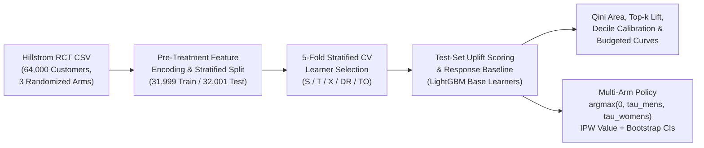

# Causal Uplift Modeling & Email Targeting (`upliftlab`)

Heterogeneous treatment effect (CATE / uplift) modeling on the **Hillstrom MineThatData 64,000-customer randomized controlled trial**: comparing **S, T, X, DR, and Transformed-Outcome learners** against standard **response-model** and **random** targeting using **Qini area with stratified bootstrap 95% confidence intervals**, **budgeted campaign curves**, **decile calibration**, and **Inverse Propensity Weighting (IPW) multi-arm policy valuation**.

## Problem Statement

Conventional marketing models rank customers by predicted purchase/visit probability given an email (`P(Y=1 | X, T=1)`). However, this targets *Sure Things* who would visit anyway rather than *Persuadables* whose behavior actually changes because of the email. Because individual causal effects (`tau(x) = E[Y(1) - Y(0) | X = x]`) are never directly observed, uplift modeling requires:

1. **Meta-learners** that isolate incremental lift from baseline propensity.
2. **Unbiased offline evaluation** using randomized holdout data (Qini curves, decile calibration, and Horvitz-Thompson IPW policy value).
3. **Rigorous uncertainty quantification** via stratified bootstrap intervals to distinguish true targeting gains from sampling noise (especially on rare outcomes like conversion).

## Architecture



## Key Capabilities

- **Reproducible RCT Data Pipeline (`upliftlab.data`)**: Downloads and SHA-256 verifies the Hillstrom dataset, extracts strictly pre-treatment customer attributes (dropping leaky/redundant `history_segment`), and performs arm-stratified train/test splits.
- **Six Comparable Learners (`upliftlab.learners`)**: Shared, pre-fixed LightGBM hyperparameters across `Response`, `SLearner`, `TLearner`, `XLearner` (Künzel et al., 2019), `DRLearner` (5-fold cross-fitted doubly robust pseudo-outcomes, Kennedy 2023), and `TransformedOutcome` (Athey & Imbens, 2015).
- **Causal Evaluation Suite (`upliftlab.evaluation`, `upliftlab.run`)**:
  - Incremental uplift curves and Qini area (0 for random targeting).
  - Top-10% / 30% / 50% observed uplift and decile predicted-vs-observed calibration.
  - Stratified bootstrap 95% CIs and paired Qini differences (`selected - response`, `selected - random`).
  - Horvitz-Thompson `ipw_value` for unbiased multi-arm policy valuation (`no_email`, `everyone_mens`, `everyone_womens`, `model_best_arm`).

## Benchmark Results

All numbers below are observed on the held-out **32,001-customer test split** from [`results/summary.json`](results/summary.json).

### Test-Set Arm Means (Hillstrom RCT)

| Arm | Visit Rate | Conversion Rate | Mean Spend ($) |
| :--- | :---: | :---: | :---: |
| `No E-Mail` | 10.598% | 0.620% | $0.614 |
| `Mens E-Mail` | 18.115% | 1.108% | $1.154 |
| `Womens E-Mail` | 15.065% | 0.935% | $1.227 |

### Binary Uplift Benchmarks (`womens_vs_none/visit`, ATE = +4.467 pp)

`s_learner` was selected via 5-fold CV on the training split and significantly outperforms both random and response-model targeting on the test set:

| Learner | Test Qini Area (95% CI) | Top-10% Uplift | Top-30% Uplift | Top-50% Uplift |
| :--- | :---: | :---: | :---: | :---: |
| **`s_learner` (CV-selected)** | **0.00811** `[0.00550, 0.01090]` | +8.75 pp | +8.07 pp | +7.56 pp |
| `x_learner` | 0.00746 `[0.00458, 0.01020]` | +7.51 pp | +7.60 pp | +6.83 pp |
| `dr_learner` | 0.00716 `[0.00429, 0.00970]` | +9.04 pp | +7.59 pp | +6.82 pp |
| `transformed_outcome` | 0.00714 `[0.00406, 0.00985]` | +6.17 pp | +7.77 pp | +6.72 pp |
| `t_learner` | 0.00663 `[0.00383, 0.00937]` | +7.17 pp | +7.61 pp | +6.78 pp |
| `response` (baseline) | 0.00435 `[0.00194, 0.00699]` | +6.08 pp | +6.16 pp | +5.81 pp |
| `random` | -0.00099 `[-0.00338, 0.00127]` | +3.09 pp | +3.71 pp | +4.00 pp |

- **Paired Qini gain (`s_learner - response`)**: **+0.00376** (`95% CI [0.00133, 0.00605]` — excludes zero).
- **Budget efficiency (`s_learner` on `womens_vs_none/visit`)**: Targeting only the top **50%** of customers captures **84.7%** of the full campaign effect (`37.81` vs `22.33` extra visits per 1,000 customers under random targeting); top **30%** captures **54.2%** (`24.19` vs `13.40`).

### Additional Pair / Outcome Findings (`results/summary.json`)

| Comparison | Test ATE | CV-Selected Learner | Selected Qini (95% CI) | Response Qini (95% CI) | Key Takeaway |
| :--- | :---: | :--- | :---: | :---: | :--- |
| `womens_vs_none/visit` | +0.04467 | `s_learner` | **0.00811** `[0.00550, 0.01090]` | 0.00435 `[0.00194, 0.00699]` | Strong heterogeneous uplift; S-learner beats response model |
| `mens_vs_none/visit` | +0.07517 | `s_learner` | 0.00098 `[-0.00164, 0.00346]` | 0.00319 `[0.00059, 0.00586]` | High uniform lift; baseline response correlates with effect |
| `mens_vs_none/conversion` | +0.00488 | `s_learner` | -0.00007 `[-0.00083, 0.00069]` | -0.00002 `[-0.00073, 0.00069]` | Sparse outcome (<1.1% conv); all CIs span zero |

## Quickstart

```bash
# Install package + dev dependencies
pip install -e ".[dev]"

# Run simulated-RCT unit tests
pytest

# Run full Hillstrom benchmark and write results/summary.json
upliftlab-run --data data/hillstrom.csv --out results
```

## Project Structure

```text
src/upliftlab/
├── data.py       # Hillstrom RCT loader, SHA-256 check, feature encoding, stratified split
├── learners.py   # Response, S, T, X, DR, and Transformed-Outcome LightGBM learners
├── evaluation.py # Incremental curves, Qini area, deciles, stratified bootstrap, IPW value
└── run.py        # End-to-end 5-fold CV selection, test evaluation, and policy valuation
tests/
└── test_core.py  # Known-CATE simulated RCT verification tests
results/
└── summary.json  # Observed Hillstrom test-set metrics and bootstrap intervals
```

## License

MIT — see [LICENSE](LICENSE).
